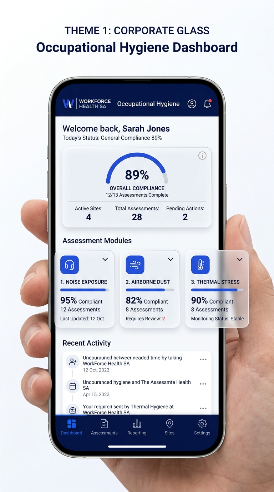
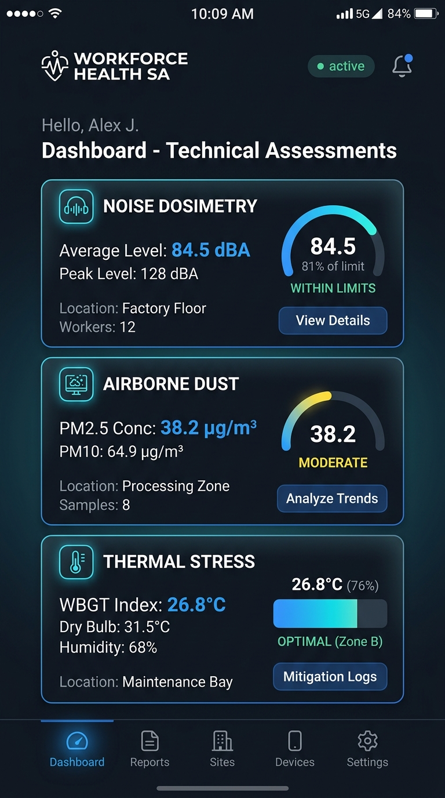
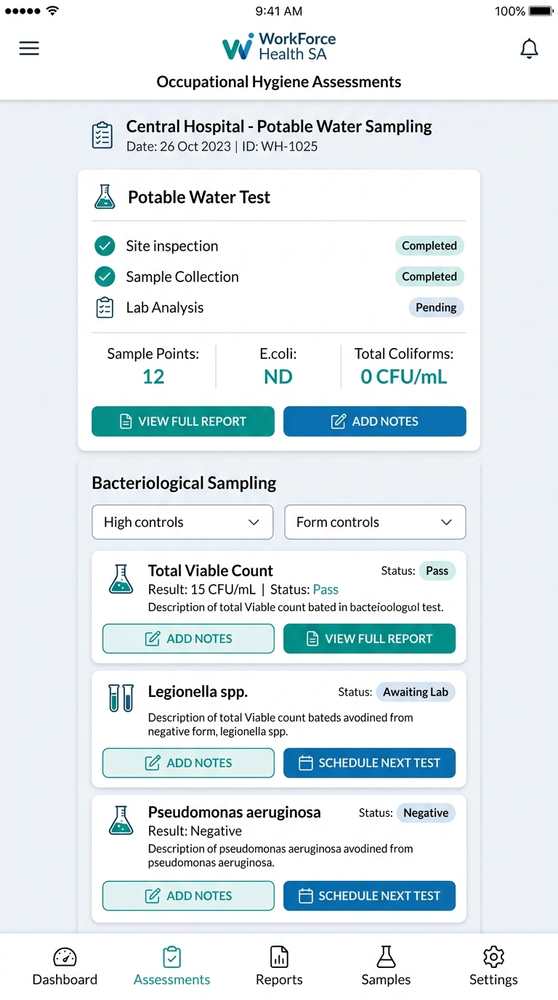
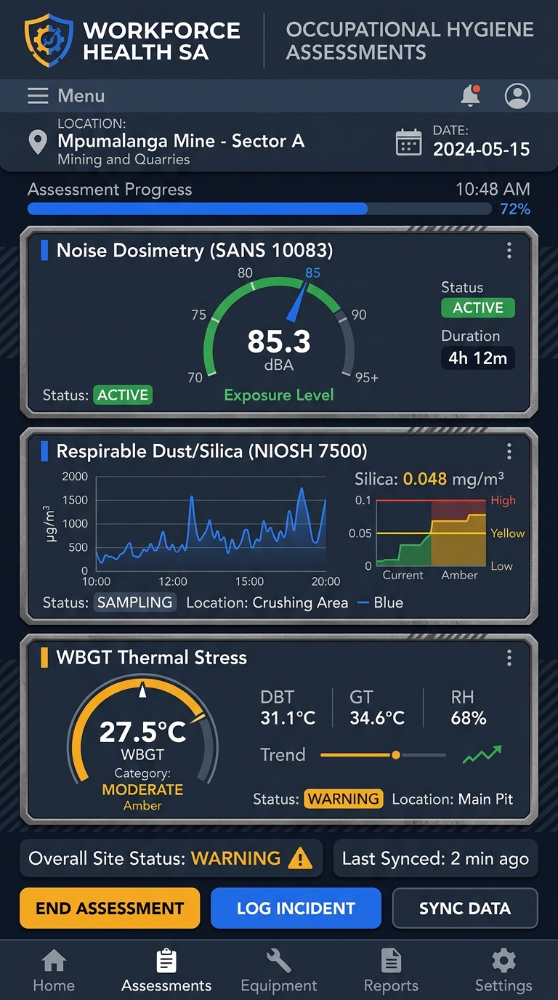

# WORKFORCE HEALTH SA — UI Theme Concept Comparison

**Application**: WorkForce Health SA (Occupational Hygiene & Environmental Engineering Portal)  
**Target Environment**: Dual-use — Corporate Boardrooms / Regulatory Offices & Harsh Industrial Field Environments (Mines, Quarries, Processing Plants, Smelters, Workshops)  
**Statutory Framework**: Mine Health and Safety Act (MHSA No. 29 of 1996), SANS Standards, NIOSH protocols  

---

## Executive Summary & Visual Overview

This document presents four alternative visual appearance concepts for the **WorkForce Health SA** mobile application. In accordance with your instructions, **no business logic, database schemas, Room entities, or assessment calculations are altered**. The existing 10 statutory assessment modules, company sites, and assessor roles are strictly preserved.

Below is a side-by-side design analysis of the four themes, accompanied by high-fidelity interface previews, color system specifications, component design tokens, and a screen-by-screen breakdown across the nine core application screens.

---

## The Four UI Theme Concepts

### 1. Theme 1: Corporate Glass
> *Executive, polished, modern corporate glassmorphism tailored for statutory presentation and executive compliance oversight.*

* **Aesthetic Philosophy**: Sophisticated translucency, crisp white surfaces, and deep corporate navy framing with vibrant royal blue primary accents. Frosted-glass cards with subtle blur (`backdrop-filter: blur(12dp)`) and layered specular reflections convey high enterprise quality.
* **Palette Tokens**:
  * **Background**: Pure Snow White (`#FFFFFF`) / Soft Porcelain Canvas (`#F8FAFC`)
  * **Primary Brand**: Royal Corporate Blue (`#1D4ED8` / `#2563EB`)
  * **Navigation Header & Base Bar**: Deep Obsidian Navy (`#0B132B` / `#0F1E36`)
  * **Surfaces & Cards**: Frosted White Glass (`rgba(255, 255, 255, 0.72)`) with subtle hairline border (`rgba(255, 255, 255, 0.6)`) and ambient soft drop shadow (`0 8px 24px -4px rgba(15, 23, 42, 0.08)`)
  * **Typography**: Deep Slate Black (`#0F172A`) for primary headers; Slate Mist (`#64748B`) for technical subtitles
* **UI Controls**:
  * **Buttons**: Rounded pills (`CornerRadius = 10dp`) in saturated corporate blue with subtle inset top gleam
  * **Gauges & Visuals**: Radial SVG compliance meters with glowing circular strokes and gradient fills
  * **Navigation**: Deep navy persistent bottom bar with active blue indicator capsules and subtle floating glow

---

### 2. Theme 2: Modern Dark
> *Ultra-sleek, technical dark interface optimized for OLED battery longevity, low-light operations, and technical precision.*

* **Aesthetic Philosophy**: Technical HUD aesthetics utilizing rich charcoal foundations, obsidian panels, and electric blue/cyan neon luminescence. High-contrast typography provides maximum visual punch with zero eye strain in dark inspection environments (such as underground quarry tunnels and evening shifts).
* **Palette Tokens**:
  * **Background**: Deep Technical Onyx (`#0B0F17`) / Rich Charcoal (`#111827`)
  * **Primary Brand & Accents**: Electric Cyan (`#38BDF8`) & Sapphire Blue (`#3B82F6`)
  * **Surfaces & Cards**: Dark Smoked Glass (`rgba(17, 24, 39, 0.85)`) with precise 1dp cyan/slate border (`rgba(56, 189, 248, 0.25)`)
  * **Typography**: Crisp Pure White (`#F9FAFB`) for headers; Silver Smoke (`#94A3B8`) for secondary text; Luminescent Cyan for telemetry values
* **UI Controls**:
  * **Buttons**: Dark charcoal capsules with electric cyan borders and glowing pulse indicators
  * **Gauges & Visuals**: Glowing arc gauges with color-coded safety zones (Cyan = Within Limits, Amber = Action Level, Crimson = Exceedance)
  * **Navigation**: Dark glass bottom dock with glowing active icon underlines

---

### 3. Clean Clinical
> *Ultra-bright, hygienic, minimal interface prioritizing immaculate legibility, sterile precision, and medical-grade clarity.*

* **Aesthetic Philosophy**: Inspired by cleanrooms, occupational health clinics, and laboratory chains of custody. Relies on pure white spaces, soft mist-grey containers, and calming teal/cobalt accents. Eliminates heavy decorative elements in favor of clean information hierarchy and instant data absorption.
* **Palette Tokens**:
  * **Background**: Pure Sterile White (`#FFFFFF`)
  * **Primary Brand**: Clean Medical Teal (`#0D9488` / `#0F766E`) & Diagnostic Cobalt (`#0284C7`)
  * **Surfaces & Cards**: Soft Dove Grey (`#F1F5F9`) with crisp 1dp hairline divider borders (`#E2E8F0`)
  * **Typography**: Neutral Slate Charcoal (`#1E293B`) in clean geometric sans-serif; high readability at micro font sizes (9–11sp)
* **UI Controls**:
  * **Buttons**: Crisp solid teal rectangular buttons with soft 8dp rounded corners
  * **Gauges & Visuals**: Linear compliance bars, clean tabular matrix checklists, pass/fail status pills
  * **Navigation**: Clean white bottom bar with soft teal icons and subtle hairline top border

---

### 4. Theme 4: Industrial Tech (Recommended)
> *Rugged, high-contrast, technical field interface designed specifically for mining, quarries, processing plants, and harsh daylight.*

* **Aesthetic Philosophy**: Engineered specifically for occupational hygiene field engineers inspecting noisy, dusty, high-vibration South African mine sites. Utilizes heavy slate textures, industrial safety blue accents, high-contrast amber warning alerts, and tactile physical buttons designed for rapid finger-tap interactions even while wearing work gloves.
* **Palette Tokens**:
  * **Background**: Deep Industrial Slate (`#0F172A`) / Technical Carbon (`#1E293B`)
  * **Primary Brand**: Industrial Technical Blue (`#2563EB`) & Safety Cobalt (`#1D4ED8`)
  * **Hazard & Warning Accents**: SABS High-Vis Amber (`#F59E0B`) & Statutory Exceedance Red (`#DC2626`)
  * **Surfaces & Cards**: Beveled Industrial Slate Cards with metallic edge trims (`#334155`) and high-contrast tactile elevations
  * **Typography**: High-legibility technical monospaced and bold sans-serif numerals for decibel levels ($L_{ex,8h}$), gravimetric concentrations ($\text{mg/m}^3$), and WBGT temperatures ($^\circ\text{C}$)
* **UI Controls**:
  * **Buttons**: Rugged tactile button blocks with high-contrast labels and physical depression state
  * **Gauges & Visuals**: SANS 10083 decibel needles, NIOSH 7500 real-time gravimetric trend charts, and dual-needle WBGT thermal meters
  * **Navigation**: Fixed industrial status rail with active sync indicator and prominent offline badge

---

## Screen-by-Screen Visual Architecture (All 9 Screens)

Here is how each of the nine required screens is structured and rendered under each theme concept, using the actual **WorkForce Health SA** modules and data:

| # | Screen Name | Actual WorkForce Health SA Content | Theme 1 (Corporate Glass) | Theme 2 (Modern Dark) | Theme 3 (Clean Clinical) | Theme 4 (Industrial Tech) |
|---|---|---|---|---|---|---|
| **1** | **Main Dashboard** | Company Selector (Letaba Crushers DME 1482), Ambient Shift Baseline (WBGT 20.8°C), Hero Banner, 10 Assessment Modules, Active Field Tasks, Room DB offline indicator. | Frosted-white cards over soft gradient background; royal blue accents; radial progress rings. | Pitch-black background; glowing cyan telemetry cards; live pulsing sensor beacons; dark glass docks. | Sterile white layout with soft dove-grey panels; teal status badges; clean clinical checklist layout. | Heavy dark slate panels (`#1E293B`); rugged high-contrast decibel meters; tactile industrial action buttons. |
| **2** | **Assessment Module Selection** | The 10 statutory protocols: Personal Noise, Airborne Pollutants, Thermal Stress, Area Noise, Day/Night Illumination, TMM Illumination, Fallout Dust, Potable Water A, Potable Water B, Ablution Facilities. | Translucent frosted-glass tiles with subtle drop shadows; blue circular icon badges; 2-column responsive grid. | Neon outlined tiles with glowing cyan/sapphire hazard icons; high-contrast dark glass cards. | Minimalist cleanroom grid; white cards with hairline borders; teal standard badges (SANS 10083, SANS 241). | Beveled slate module tiles; rugged category color tabs; prominent statutory DME reference tags. |
| **3** | **Assessment Form** | Calibration pre/post checks (SVANTEK SV33B 114.0 dBA), HEG selection, sampling pumps, gravimetric filter numbers, digital signature pad, photo attachments. | Floating glass cards for each section; smooth rounded input fields; navy signature box; blue accent switches. | Dark HUD form inputs with cyan focus halos; dark-grey signature surface; glowing validation ticks. | High-contrast clinical form layout; sterile white text boxes; teal radio selectors; crisp medical verification. | Rugged technical inputs with high touch targets (52dp min); high-contrast amber warning flags for OEL exceedances. |
| **4** | **Calendar & Task Scheduling** | Upcoming statutory mine visits, scheduled gravimetric filter retrievals, annual noise dosimetry calibration cycles for client mines. | Translucent monthly calendar grid with soft rounded date bubbles; royal blue scheduled event pills. | Dark calendar grid with glowing date pips; technical countdown badges for statutory audit deadlines. | Clean medical appointment schedule view; crisp white day blocks; clear teal time-slot indicators. | Industrial shift schedule matrix; daylight/night shift color bands; quarry blasting schedule markers. |
| **5** | **Document Register** | Statutory Part 1 (Summary) & Part 2 (Technical) Reports, DMRE compliance certificates, Equipment calibration certificates, Chain of Custody forms. | Elegant document cards with PDF thumbnail previews; soft glass reflections; 1-tap download & share buttons. | Dark document vault cards; glowing file-type badges; encrypted cryptographic hash indicators. | Clean tabular file register with crisp metadata columns (Size, Author, Rev date, DMRE Status). | Heavy-duty file register with industrial inspection stamp watermarks and certified equipment serial links. |
| **6** | **Assessor Profile** | Assessor name (e.g. Dr. M. Dlamini, J. Naidoo), SAIOH registration numbers (MOH Reg #OH0412), designation, certified tool authorizations. | Premium executive ID card with frosted acrylic styling; verified blue shield badge; clean certification pills. | Dark technical credentials card with holographic cyan avatar ring; glowing security clearance chips. | Clean medical accreditation profile card; clinical registration stamp; plain readable credential listing. | Industrial hard-hat photo badge; SANS competency stamps; laminated field pass visual styling. |
| **7** | **Analytics & Reports** | D3/Charts distribution of assessments, OEL exceedance percentage (85 dBA, 0.1 mg/m³ silica), open remedial actions per mine site. | Smooth interactive area charts with soft gradient fills; frosted summary statistic cards with blue KPI labels. | Cyberpunk technical graphs with glowing neon lines; dark telemetry sparklines; high-contrast HUD cards. | Clean clinical scatter plots and bar graphs with teal and cobalt bars; medical statistical confidence intervals. | Rugged industrial bar gauges; threshold limit warning lines in amber/red; tactical quarry risk heatmaps. |
| **8** | **Notifications** | WorkManager background sync alerts, calibration overdue warnings, statutory remedial action escalations, OEL exceedance alerts. | Floating translucent banner toasts with soft shadow; blue and amber notification badges. | Dark glass cards with glowing left-edge priority indicator bars (Red = Critical, Cyan = Info). | Clean list of message items with clear severity icon stamps; zero clutter; instant one-tap dismiss. | High-visibility hazard alert cards with industrial hazard stripes on critical alerts; tactile acknowledge button. |
| **9** | **Settings** | Mine site master DME configs, Dark Mode toggle, Theme switcher, Room DB cache optimizer, User role access switcher (Admin, Reviewer, Assessor). | White settings list with smooth rounded group cards; navy icons; blue animated switch toggles. | Dark charcoal settings sections; glowing cyan toggles; technical storage and memory telemetry readouts. | Clean medical system preferences list; minimal switches; crisp section dividers; pure white surfaces. | Technical system control console with hardware storage gauges, database vacuum buttons, and sync diagnostics. |

---

## Detailed Comparison Matrix

| Evaluation Criteria | Theme 1: Corporate Glass | Theme 2: Modern Dark | Theme 3: Clean Clinical | Theme 4: Industrial Tech |
|---|---|---|---|---|
| **Direct Sunlight Readability** | Moderate (Reflections on mobile screens) | Fair (Requires high screen brightness) | High (Pure white high contrast) | **Highest** (Dark slate + high-contrast text & amber highlights) |
| **Harsh Industrial Usability (Dust/Glares)** | Fair | Good | Fair | **Superior** (Tactile buttons, large touch targets, bold gauges) |
| **Executive / Boardroom Appeal** | **Highest** (Premium & elegant) | High (Modern tech feel) | Moderate (Looks medical/clinical) | High (Authentic engineering authority) |
| **OLED Battery Efficiency** | Standard | **Maximum** (~40% battery savings) | Standard | Very High (~30% battery savings) |
| **Eye Fatigue in 8h Field Shifts** | Moderate | Very Low | Moderate | **Lowest** (Balanced slate tones prevent glare fatigue) |
| **Brand Identity Fit** | Enterprise Corporate | Modern High-Tech | Occupational Health Clinic | **Mining & Industrial Occupational Hygiene** |

---

## Technical Architecture & Zero-Logic-Impact Implementation Plan

When you confirm your theme choice:
1. **No Business Logic Changes**:
   - `SiteHygieneDatabase.kt`, DAOs, and repository classes remain 100% untouched.
   - All 10 modules in `AssessmentType` remain identical.
   - All forms, calculations ($L_{ex,8h}$, WBGT index, gravimetric concentrations), PDF generators, and sync workers remain identical.
2. **Implementation Scope**:
   - `Color.kt`: Centralize color tokens for the selected theme concept.
   - `Theme.kt`: Update `MaterialTheme.colorScheme` and provide specialized component styles (custom Card shapes, elevations, and button borders).
   - `IndustrialCards.kt` & `TopAndBottomBars.kt`: Adjust container styling, corner radii, and icons to match the chosen design language.

---

## Professional Recommendation

### **Recommended Selection: THEME 4 (INDUSTRIAL TECH)**

**Rationale**:
1. **Operational Environment Realism**: WorkForce Health SA’s primary application users are occupational hygiene assistants, hygienists, and mine managers working at mines and quarries (e.g. Letaba Crushers, Phalaborwa Copper, Limpopo Sands). Field assessments occur outdoors in direct sunlight, inside noisy crusher plants, and in dusty underground processing areas.
2. **High-Contrast Safety Telemetry**: Theme 4's slate surfaces combined with vivid cobalt blue and high-vis safety amber alert badges offer the highest legibility and instant hazard recognition when monitoring statutory threshold exceedances (SANS 10083 noise > 85 dBA, silica > 0.1 mg/m³, WBGT heat > 27.5°C).
3. **Tactile Industrial Usability**: The larger touch targets, beveled cards, and rugged action buttons are specifically engineered for field workers using smartphones and rugged tablets with protective cases or safety gloves.
4. **Office & Executive Adaptability**: While rugged in the field, Theme 4’s clean technical instrumentation and precision charts look exceptionally authoritative during client presentations, DMRE statutory audits, and boardroom compliance reviews.

*(Alternative Recommendation: If you prefer a lighter, corporate aesthetic for executive tablet presentations, **THEME 1 (CORPORATE GLASS)** is the strongest secondary contender).*

---

### Waiting for Your Selection

Please review the four visual concepts and reply with your preference:
* **Option 1**: Apply **THEME 1: CORPORATE GLASS**
* **Option 2**: Apply **THEME 2: MODERN DARK**
* **Option 3**: Apply **THEME 3: CLEAN CLINICAL**
* **Option 4**: Apply **THEME 4: INDUSTRIAL TECH** (Recommended)

Once you make your choice, I will apply the complete styling across all screens while preserving all existing application logic.
